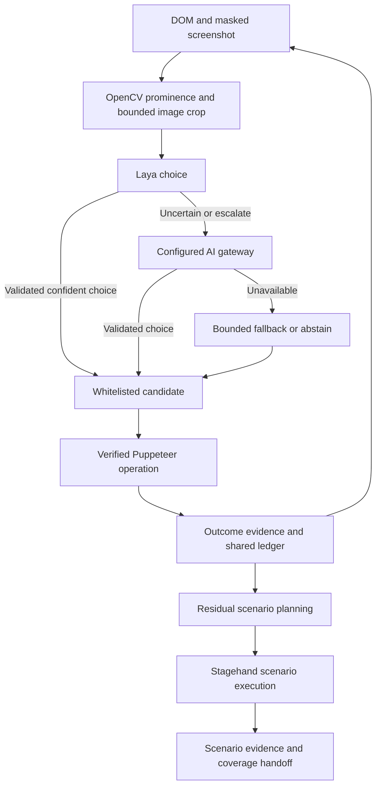

# Autonomous resource coordination

The same Puppeteer browser is observed through DOM state and masked screenshots. OpenCV adds image-derived rankings; Laya makes a bounded local choice. Only uncertain, unavailable, or explicitly escalated Laya decisions invoke the configured OpenAI-compatible AI gateway. The gateway can choose only from the supplied keys, not invent selectors or scripts.



## Decisions and payloads

- Next-action choices are restricted to at most 14 current candidates plus an escalation key. Model responses must contain an exact allowed key and numeric confidence from 0.65 to 1. Missing/invalid confidence does not become an invented confidence of 1.
- OpenCV remains image analysis rather than a semantic login oracle. Its actual engine, including heuristic fallback when OpenCV cannot initialize, is included in the decision context.
- Laya receives `{state:{image,note},questions}` when image evidence is available. This contains actual JPEG image bytes as a data URI, not a screenshot URL embedded in JSON text.
- Screenshots are masked before processing. Relevant candidate regions are cropped with padding and reduced to at most 960 by 720 pixels. Gateway fallback receives compact DOM/visual summaries and bounded choice descriptions, not a second full screenshot.
- Identical context/choices/image evidence are cached for 30 seconds within the controller. Changed context invalidates the cache. Unavailable Laya requests use a 30-second cooldown. Calls have bounded timeouts; busy responses and alternate Laya endpoints share the request time budget.
- `job.autonomousDecisionTrace` records source, confidence, cache use, actual request counts, whether image data was submitted, diagnostics, and provider-reported prompt/completion token counts when available. It stores no raw image or prompt. This does not claim a measured monetary saving or complete accounting of Stagehand's internal model calls.

## Execution ownership and evidence

The human-like loop reuses the verified radio, checkbox/switch, native select, text-entry and attachment helpers from Full App execution. A dropdown is not passed merely because options exist. Execution results, not the model's confidence, determine the action verdict.

Puppeteer and Stagehand receive exclusive phase ownership through `withAutonomousExecutor`; attempts to overlap controllers fail. Stagehand's residual scenario planner and scenario instruction receive resolved/pending ledger coverage and previous scenario results. This is coverage context for an opaque higher-level agent, not a claim that every internal Stagehand action is intercepted or deduplicated. Repeated prerequisites can be necessary for distinct scenarios.

If no configured remote-model credentials are available, DOM/OpenCV/Laya work can continue. The unavailable Stagehand scenario stage is explicitly reported as blocked, rather than preventing all browser work or claiming a complete model-driven run.

## Form purpose

`hasLoginWall` now delegates to form-level intent. Explicit primary submit actions and field structure distinguish login, sign-up, reset and ordinary forms. A password alone, or a header Sign in link, is insufficient. A login widget beside usable public forms does not make the whole page an authentication wall. Ambiguous forms use the same Laya/gateway controller; uncertainty remains `unknown` and does not trigger a credential prompt. Form classification sends metadata, not entered field values.

## Validation and focused debugging

```sh
npx puppeteer browsers install chrome-headless-shell
npm run test:input-execution
npm run test:autonomous-decisions
npm run typecheck
```

Tests use real Chromium for DOM, image preparation, OpenCV, form intent and verified candidate execution. Controlled Laya/gateway responses validate request payloads, escalation, whitelist checks, caching, token reporting, failure behavior and coverage handoff without consuming real model credits. They do not substitute for a final run against the user's actual Laya and gateway endpoints.

To rerun a focused integration case:

```sh
npx --yes tsx --test --test-name-pattern="real DOM/OpenCV/Laya" tests/autonomous-loop.integration.test.ts
npx --yes tsx --test --test-name-pattern="form intent" tests/autonomous-loop.integration.test.ts
```

The existing dependency-lock mismatch is documented in INPUT_EXECUTION_FIX.md. No new dependencies were added for this coordination layer.
